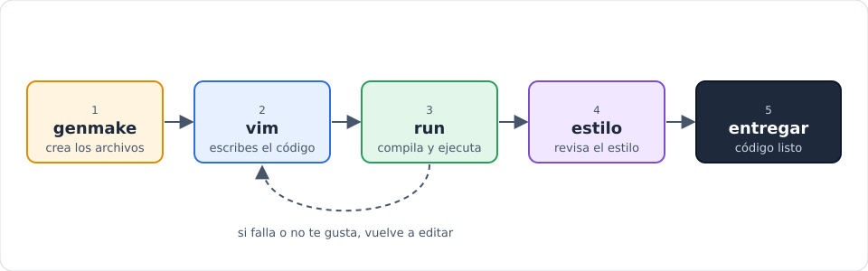

# ib-tools

*Español: [README.md](README.md)*

Small commands that save you repetitive work in **C++** programming labs at any university: create the Makefile and files of each exercise, compile and run with one command, and check code style before handing in.

> Student project, unofficial, not affiliated with any university. Built first for a Spanish intro course, but file headers adapt to your own details.



## What's included

| Command | What it does |
| --- | --- |
| `nuevo` | Creates the exercise folder and runs `genmake` inside: `nuevo square`. |
| `genmake` | Creates the `Makefile`, the main program and, optionally, a functions file with its `.h`. Asks step by step. |
| `run` | Rebuilds from scratch and runs the program. If it doesn't compile, it doesn't run. |
| `estilo` | Checks Google style (cpplint) and compiler warnings. `-f` fixes formatting for you. |
| `ib-config` | Shows and edits your profile: name, email, university, school, degree, subject, year, language. |
| `ib-update` | Updates to the latest version with one command. |

(`estilo` is Spanish for "style"; commands keep their names, but messages follow your language.)

## Quick install

On the lab virtual machine (or any Linux with `g++` and `make`):

```bash
git clone https://github.com/Broslunas/ib-tools.git
cd ib-tools
./install.sh
```

Or without cloning:

```bash
curl -fsSL https://raw.githubusercontent.com/Broslunas/ib-tools/main/install.sh | bash
```

The installer asks for your profile (name, email, university, school, degree, subject, academic year); it appears in the header of your files. Full guide: [docs/en/installation.md](docs/en/installation.md).

## 30-second tour

```bash
nuevo square         # creates the folder and asks the genmake questions
cd square            # (Enter = default for each question)
vim square_main.cc   # write your code
run 7                # build and run with argument 7
estilo               # check style before handing in
```

## Documentation

- [Step-by-step installation](docs/en/installation.md)
- [genmake, run, estilo](docs/en/commands.md)
- [ib-config and ib-update](docs/en/profile.md)
- [Troubleshooting](docs/en/troubleshooting.md)

Screenshots live in the Spanish docs ([docs/](docs/instalacion.md)).

## Extras

- **Tab** completes commands and options.
- **Colors** in `run` and `estilo`; disable with `NO_COLOR=1`.
- **Website** in [docs/index.html](docs/index.html) (published via GitHub Pages, see [CONTRIBUTING.md](CONTRIBUTING.md)).
- **Problems or ideas:** open an [issue](https://github.com/Broslunas/ib-tools/issues/new/choose).
- **Versions:** [CHANGELOG.md](CHANGELOG.md) and [releases](https://github.com/Broslunas/ib-tools/releases).

## Author and license

By Pablo Luna ([Broslunas](https://github.com/Broslunas), pablo@broslunas.com). [MIT](LICENSE) license.
