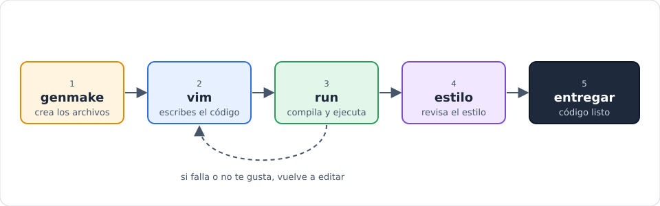
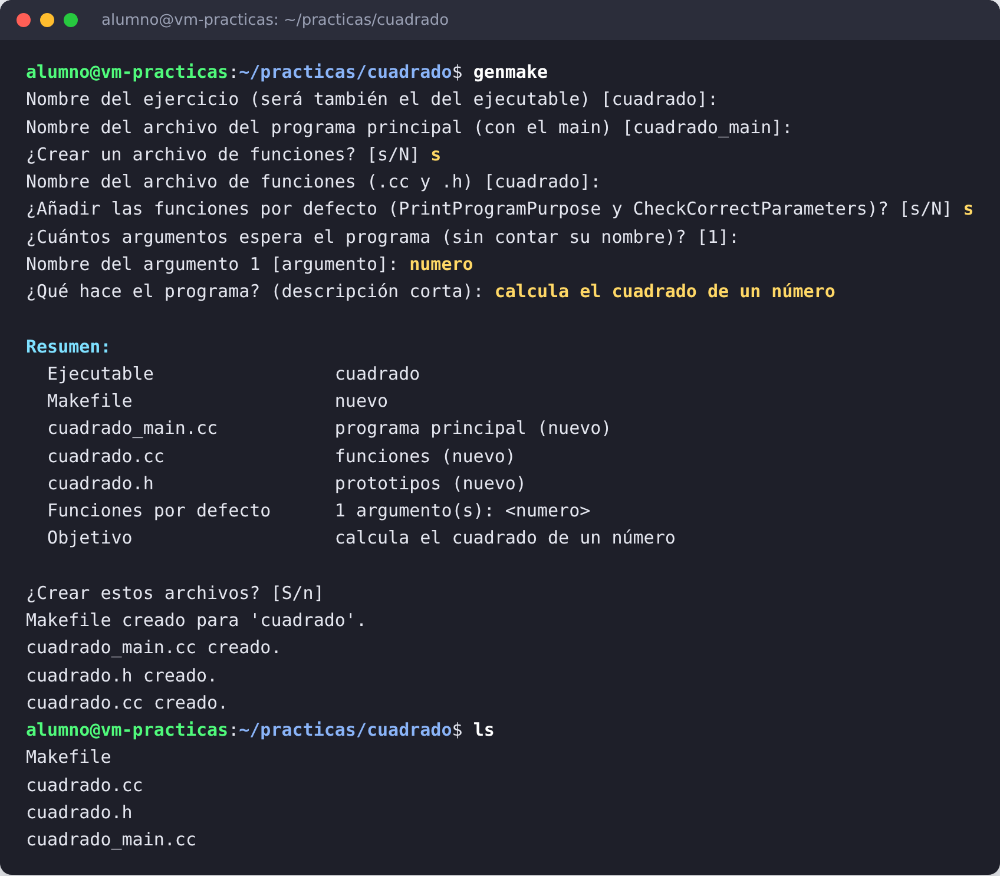

# ib-tools

*English: [README.en.md](README.en.md)*

Comandos para ahorrarte trabajo repetitivo en las prácticas de programación en **C++** de cualquier universidad: crear el Makefile y los archivos de cada ejercicio, compilar y ejecutar con un solo comando, y revisar el estilo del código antes de entregar.

> Proyecto de estudiantes, no oficial. No está afiliado a ninguna universidad. Pensado primero para Informática Básica (ULL), pero la cabecera se adapta a tus datos.



## Qué incluye

| Comando | Para qué sirve |
| --- | --- |
| `genmake` | Crea el `Makefile`, el programa principal y, si quieres, un archivo de funciones con su `.h`. Te va preguntando paso a paso. |
| `run` | Recompila desde cero y ejecuta el programa. Si no compila, no lo ejecuta. |
| `estilo` | Revisa el estilo de Google (cpplint) y los avisos del compilador. Con `-f` corrige el formato solo. |
| `ib-config` | Muestra y cambia tu perfil: nombre, correo, universidad, centro, titulación, asignatura, curso e idioma. |
| `ib-update` | Se actualiza a la última versión con un solo comando. |

## Instalación rápida

Dentro de la máquina virtual de prácticas (o cualquier Linux con `g++` y `make`):

```bash
git clone https://github.com/Broslunas/ib-tools.git
cd ib-tools
./install.sh
```

O, sin clonar nada:

```bash
curl -fsSL https://raw.githubusercontent.com/Broslunas/ib-tools/main/install.sh | bash
```

El instalador te pide tu perfil (nombre, correo, universidad, centro, titulación, asignatura y curso; salen en la cabecera de tus archivos) y deja los comandos en `~/.local/bin`. La guía completa, con capturas, está en [docs/instalacion.md](docs/instalacion.md).

## Uso en 30 segundos

```bash
mkdir cuadrado && cd cuadrado
genmake              # contesta las preguntas (Enter = valor por defecto)
vim cuadrado_main.cc # escribes tu código
run 7                # compila y ejecuta con el argumento 7
estilo               # revisa el estilo antes de entregar
```



## Documentación

- [Instalación paso a paso](docs/instalacion.md)
- [genmake: crear un ejercicio](docs/genmake.md)
- [run: compilar y ejecutar](docs/run.md)
- [estilo: revisar y corregir el código](docs/estilo.md)
- [ib-config e ib-update: perfil y actualizaciones](docs/perfil.md)
- [Problemas frecuentes](docs/problemas.md)

## Idiomas

Los comandos hablan español o inglés según el idioma de tu sistema; con `ib-config` puedes fijarlo. Documentación en inglés: [README.en.md](README.en.md) y [docs/en/](docs/en/installation.md).

## Autor y licencia

Hecho por Pablo Luna ([Broslunas](https://github.com/Broslunas), pablo@broslunas.com). Licencia [MIT](LICENSE): puedes usarlo y modificarlo libremente.
