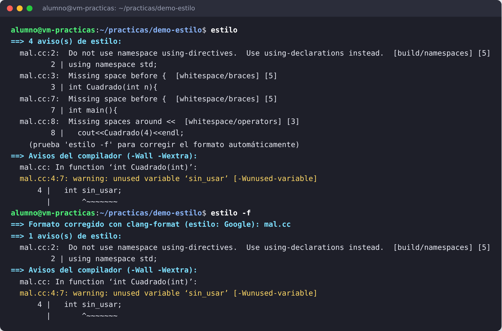

# estilo: revisar y corregir el código

`estilo` revisa tu código antes de entregarlo. Usa dos herramientas:

- **cpplint**, que comprueba la guía de estilo de Google (espacios, llaves, `using namespace`, longitud de línea...).
- **El compilador** (`g++ -Wall -Wextra`), que avisa de cosas como variables sin usar.

## Cómo se usa

```bash
estilo                 # revisa todos los .cc y .h de la carpeta
estilo cuadrado.cc     # revisa solo ese archivo
estilo -f              # corrige el formato y después revisa
```



Cada aviso trae el archivo, la línea, el motivo y, debajo, **la línea de código** que lo provoca.

En el ejemplo, el primer `estilo` encuentra cuatro avisos de estilo y uno del compilador. Después, `estilo -f` arregla solos los de formato (los espacios y las llaves) y deja los que hay que resolver a mano: borrar `using namespace std;` y la variable `sin_usar`.

## Qué hace `-f`

Ejecuta `clang-format` con el estilo de Google **sobre tus archivos** (los modifica). Arregla la indentación, los espacios y las llaves. No cambia lo que hace tu programa.

Si en tu carpeta, o en una superior, hay un archivo `.clang-format`, usa ese en lugar del estilo de Google.

> Haz `-f` cuando tu código ya esté guardado y, si quieres estar seguro, haz antes una copia o un commit.

## Qué avisos ignora

Para no darte ruido innecesario, `estilo` desactiva tres comprobaciones de cpplint que no tienen sentido en las prácticas:

- el aviso de copyright,
- el de poner la ruta en los `#include "archivo.h"`,
- el de los *include guards* con la ruta completa del proyecto.

## Qué necesita

`clang-format` (para `-f`) y `cpplint` (para la revisión de estilo). El [instalador](instalacion.md) te ofrece instalarlos. Sin `cpplint`, `estilo` te avisa y sigue con la revisión del compilador.

## Código de salida

`estilo` termina con `0` si no hay avisos y con `1` si encontró alguno.
