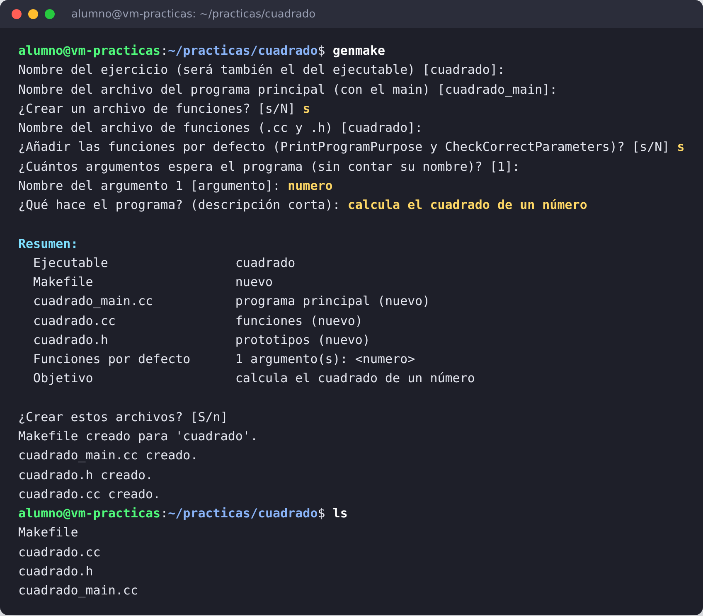
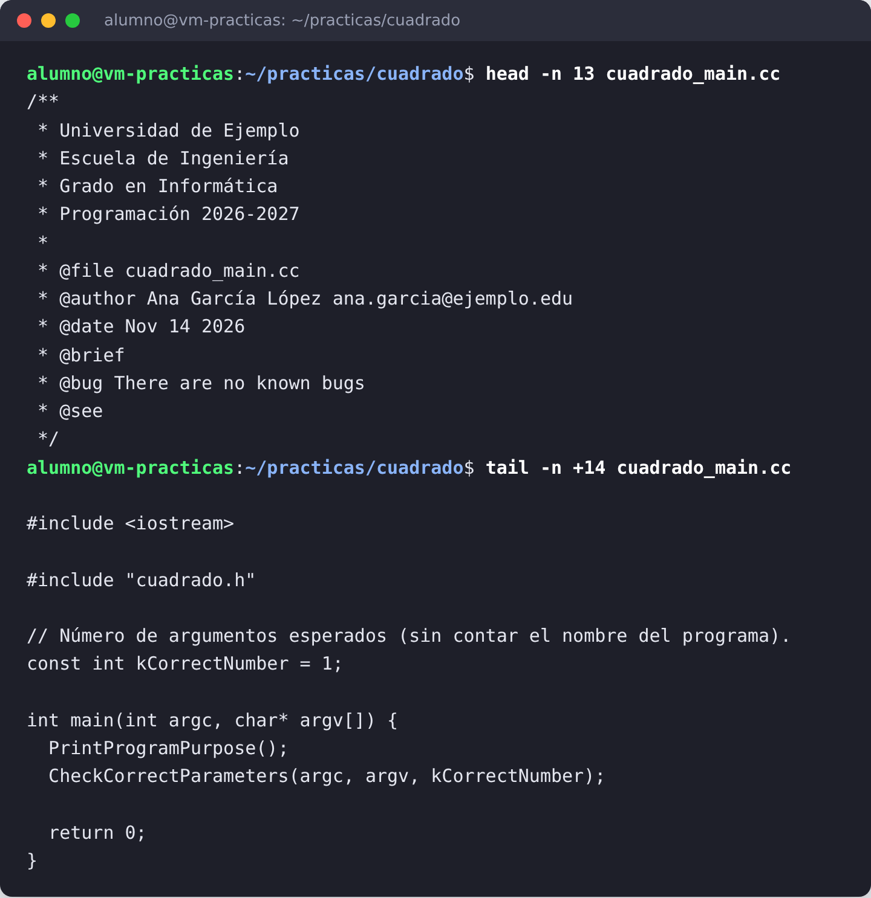
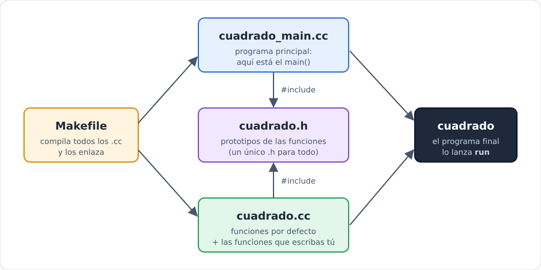

# genmake: crear un ejercicio

`genmake` prepara la carpeta de un ejercicio: el `Makefile`, el programa principal y, si quieres, un archivo de funciones con su `.h`. Te va haciendo preguntas una a una y, antes de escribir nada, te enseña un resumen para que confirmes.

## Cómo se usa

Crea una carpeta para el ejercicio, entra en ella y ejecuta `genmake`:

```bash
mkdir cuadrado
cd cuadrado
genmake
```

También puedes darle el nombre directamente y se salta esa pregunta:

```bash
genmake cuadrado
```



Los valores entre corchetes son los que se usan si pulsas **Enter** sin escribir nada. En las preguntas de sí o no, la letra en mayúscula es la respuesta por defecto (`[s/N]` es "no", `[S/n]` es "sí").

## Las preguntas, una a una

| Pregunta | Qué significa |
| --- | --- |
| **Nombre del ejercicio** | Es también el nombre del ejecutable. Propone el de la carpeta en la que estás. |
| **Nombre del archivo del programa principal** | El archivo que contiene el `main()`. Propone `<nombre>_main`. |
| **¿Crear un archivo de funciones?** | Si dices que sí, crea `<nombre>.cc` y `<nombre>.h` para tus funciones, y pregunta cómo llamarlos. |
| **¿Añadir las funciones por defecto?** | Añade `PrintProgramPurpose` y `CheckCorrectParameters` al archivo de funciones. Solo aparece si creas ese archivo. |
| **¿Cuántos argumentos espera el programa?** | El valor de `kCorrectNumber`: argumentos de la línea de comandos, sin contar el nombre del programa. |
| **Nombre del argumento N** | Cómo se llama cada argumento. Sale en el mensaje de uso: `Modo de uso: ./cuadrado <numero>`. |
| **¿Qué hace el programa?** | Frase corta que imprime `PrintProgramPurpose`. Si la dejas vacía, queda un texto para que lo cambies tú. |
| **¿Crear estos archivos?** | Resumen final. Hasta que respondas `S` no se escribe nada. |

### Las funciones por defecto

Son dos funciones que sirven de plantilla para programas que reciben argumentos:

- `PrintProgramPurpose()` imprime una frase sobre lo que hace el programa.
- `CheckCorrectParameters(argc, argv, kCorrectNumber)` comprueba que se pasaron los argumentos esperados. Si no, muestra el modo de uso y termina el programa con error.

El `main` generado ya las llama al principio:

La cabecera sale de tu perfil, y el `main` ya llama a las funciones por defecto:



## Qué archivos crea

Para un ejercicio llamado `cuadrado`, con funciones y funciones por defecto:



| Archivo | Contenido |
| --- | --- |
| `Makefile` | Compila todos los `.cc` de la carpeta y genera el ejecutable. |
| `cuadrado_main.cc` | El programa principal, con la cabecera y el `main()`. |
| `cuadrado.h` | Los prototipos de las funciones. Es el único `.h`. |
| `cuadrado.cc` | Las funciones por defecto y, debajo, las que escribas tú. |

Cuando añadas una función tuya en `cuadrado.cc`, pon su prototipo en `cuadrado.h` y ya podrás usarla desde `cuadrado_main.cc`.

## Si un archivo ya existe

`genmake` **nunca toca los `.cc` ni los `.h` que ya existen**: te lo dice y los deja como están. El `Makefile` sí se reescribe, sin preguntar, para que siempre apunte a los nombres correctos. En el resumen verás marcado qué se va a crear y qué ya existía.

## Modo rápido: `-y`

```bash
genmake cuadrado -y
```

Acepta todos los valores por defecto sin preguntar nada: crea el `Makefile` y `cuadrado_main.cc`, sin archivo de funciones. Sin nombre (`genmake -y`) usa el de la carpeta actual.

## El Makefile

Tiene dos variables al principio:

```make
PROGRAMA := cuadrado        # nombre del ejecutable
MAIN     := cuadrado_main   # archivo (sin .cc) con el main()
```

Compila **todos** los `.cc` de la carpeta, así que solo debe haber un `main()` por carpeta. Usa un ejercicio por carpeta.

`make clean` borra los `.o`, el ejecutable y los archivos temporales de Vim (`.*.swp`).

## Tu plantilla de Vim (opcional)

Si tienes un archivo `~/.vim/skeleton.cc`, `genmake` lo usa como base del programa principal. Sustituye dos palabras:

- `FILENAME` por el nombre del archivo.
- `DATE` por la fecha de hoy (por ejemplo `Nov 14 2026`).

Para que se puedan añadir las funciones por defecto, tu plantilla debe contener la línea `int main() {` tal cual. Si no tienes plantilla, `genmake` usa una por defecto.

## Tus datos en la cabecera

La cabecera de cada archivo y del `Makefile` sale de tu perfil (`ib-config`): universidad, centro, titulación, asignatura con el curso, y tu nombre y correo en `@author`. Los campos que dejaste vacíos no aparecen. Así funciona con cualquier universidad:

```cpp
/**
 * Universidad de Ejemplo
 * Escuela de Ingeniería
 * Grado en Informática
 * Programación 2026-2027
 *
 * @file cuadrado_main.cc
 * @author Ana Pérez ana@ejemplo.edu
 * @date Nov 14 2026
 ...
```

Para cambiar esos datos mira [ib-config e ib-update](perfil.md). Los mensajes de `genmake` y el texto de las funciones por defecto salen en español o inglés según el idioma de tu perfil.
