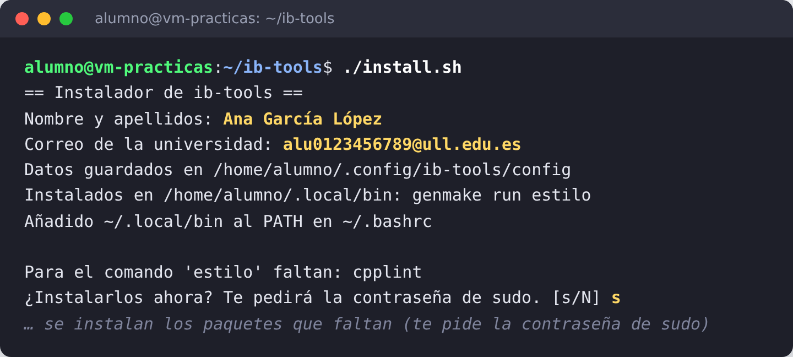

# Instalación paso a paso

Esta guía te lleva desde cero hasta tener `genmake`, `run`, `estilo`, `ib-config` e `ib-update` funcionando. Tarda unos cinco minutos.

## Qué necesitas

- Una terminal de Linux. Normalmente, la de la **máquina virtual de prácticas**.
- `g++` y `make` (en la VM de prácticas ya están).
- `git` **o** `curl`, para descargar las herramientas.
- Opcional, para el comando `estilo`: `clang-format` y `cpplint`. El instalador te ofrece instalarlos.

### Comprueba que lo tienes

Copia estas líneas en la terminal. Cada una debe mostrar un número de versión:

```bash
g++ --version
make --version
git --version
```

Si alguna dice `command not found`, instálala con `sudo apt install g++ make git` (te pedirá la contraseña de sudo).

## Paso 1. Descarga las herramientas

Elige **una** de estas dos formas.

### Opción A: clonar el repositorio (recomendada)

```bash
git clone https://github.com/Broslunas/ib-tools.git
cd ib-tools
```

Es la mejor opción porque después puedes actualizar con un solo comando.

### Opción B: una línea con curl

No hace falta clonar nada. Salta al paso 2 con este comando, que descarga y ejecuta el instalador:

```bash
curl -fsSL https://raw.githubusercontent.com/Broslunas/ib-tools/main/install.sh | bash
```

> Es buena costumbre mirar un script antes de ejecutarlo. Puedes leerlo en [install.sh](../install.sh): copia cinco archivos a `~/.local/bin` y añade esa carpeta al `PATH`.

## Paso 2. Ejecuta el instalador

Si has clonado el repositorio:

```bash
./install.sh
```



El instalador hace esto, en orden:

1. **Copia `genmake`, `run`, `estilo`, `ib-config` e `ib-update`** a `~/.local/bin`.
2. **Te pregunta tu perfil** (con `ib-config`): idioma, nombre, correo, universidad, centro, titulación, asignatura y curso académico. Solo nombre y correo son obligatorios; el curso se propone según la fecha (por ejemplo `2026-2027`) y en lo demás Enter deja el campo vacío. Se guarda en `~/.config/ib-tools/config` y sale en la cabecera de los archivos que crea `genmake`.
3. **Añade `~/.local/bin` al `PATH`** en tu `~/.bashrc`, si hacía falta.
4. **Te ofrece instalar `clang-format` y `cpplint`**, que usa el comando `estilo`. Responde `s` y escribe la contraseña de sudo cuando la pida (no se ve mientras la escribes, es normal). Si respondes `n`, `genmake` y `run` funcionan igual y `estilo` te avisará de qué le falta.

## Paso 3. Abre una terminal nueva

Para que el sistema encuentre los comandos nuevos, cierra la terminal y abre otra. Si no quieres cerrarla, ejecuta:

```bash
source ~/.bashrc
```

## Paso 4. Comprueba que funciona

```bash
which genmake run estilo ib-config ib-update
```

Debe mostrar cinco rutas dentro de `~/.local/bin`. Haz ahora una prueba completa:

```bash
mkdir ~/prueba && cd ~/prueba
genmake -y
ls
```

Tiene que crear un `Makefile` y un archivo `prueba_main.cc`. Si es así, ya está todo listo. Puedes borrar la carpeta de prueba con `cd .. && rm -r prueba`.

Siguiente paso: [cómo se usa genmake](genmake.md).

## Actualizar a una versión nueva

Un solo comando, desde cualquier carpeta:

```bash
ib-update
```

Descarga la última versión y no vuelve a preguntarte nada: tu perfil se conserva. Además, `genmake` te avisa con discreción (como mucho una vez por semana) cuando hay una versión nueva.

## Cambiar tu perfil

```bash
ib-config          # te vuelve a preguntar; Enter conserva cada valor
ib-config --ver    # solo muestra lo que hay guardado
```

Los archivos que ya creaste no cambian; solo los nuevos. Más detalles en [ib-config e ib-update](perfil.md).

## Desinstalar

Desde la carpeta del repositorio:

```bash
./install.sh --desinstalar
```

Borra los cinco comandos de `~/.local/bin`. Tus datos siguen en `~/.config/ib-tools/config`; bórralos a mano si quieres (`rm -r ~/.config/ib-tools`).

## ¿Algo ha ido mal?

Mira [Problemas frecuentes](problemas.md).
