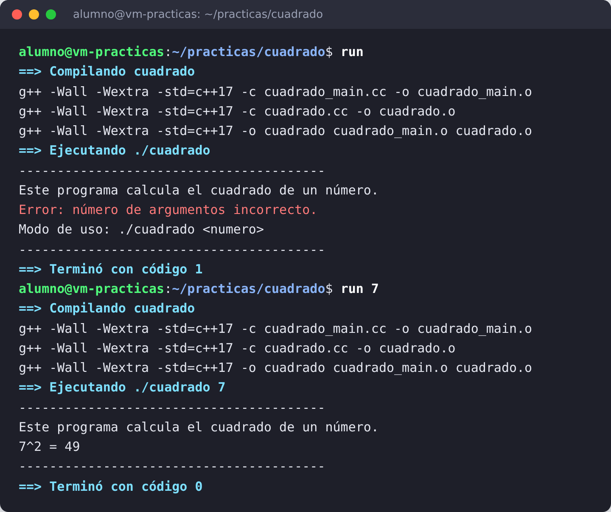

# run: compilar y ejecutar

`run` hace en un solo comando lo que harías a mano cada vez que cambias el código: limpiar, compilar y ejecutar.

## Cómo se usa

Desde la carpeta del ejercicio (donde está el `Makefile`):

```bash
run
```

Si tu programa recibe argumentos, escríbelos detrás de `run` y se los pasa tal cual:

```bash
run 7
run 3 4 hola
```



En la captura, el primer `run` no pasa el argumento que el programa espera, y `CheckCorrectParameters` muestra el modo de uso. El segundo `run 7` funciona.

## Qué hace, paso a paso

1. Lee del `Makefile` el nombre del ejecutable (la variable `PROGRAMA`).
2. Ejecuta `make clean`, para recompilar todo desde cero.
3. Lanza [`estilo -q`](estilo.md) y te muestra los avisos de estilo. **Solo avisa**: no impide compilar.
4. Compila con `make`. Si hay errores, los muestra y **no ejecuta nada**.
5. Ejecuta el programa entre dos líneas de guiones y al terminar te dice con qué código salió (`0` si todo fue bien).

## Cosas a tener en cuenta

- Los mensajes salen en colores (verde si termina bien, rojo si falla). Para quitarlos: `NO_COLOR=1 run`.
- `make clean` borra también los archivos temporales de Vim (`.*.swp`) de esa carpeta. Si tienes un archivo abierto en Vim y ejecutas `run` desde otra terminal, se borrará su `.swp`; no pierdes tu código, pero Vim ya no tendrá la protección de ese archivo.
- Si no hay `Makefile` en la carpeta, `run` te lo dice. Créalo con [`genmake`](genmake.md).
